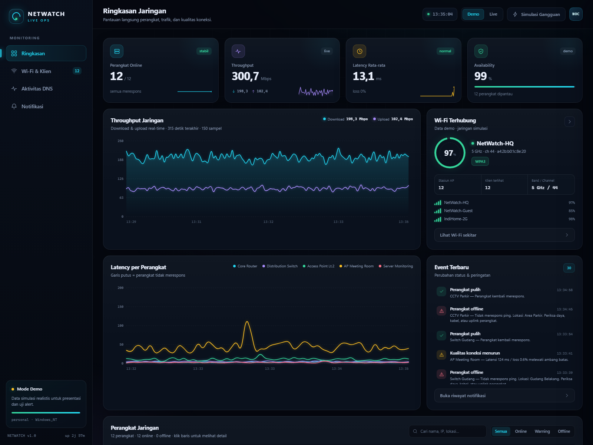
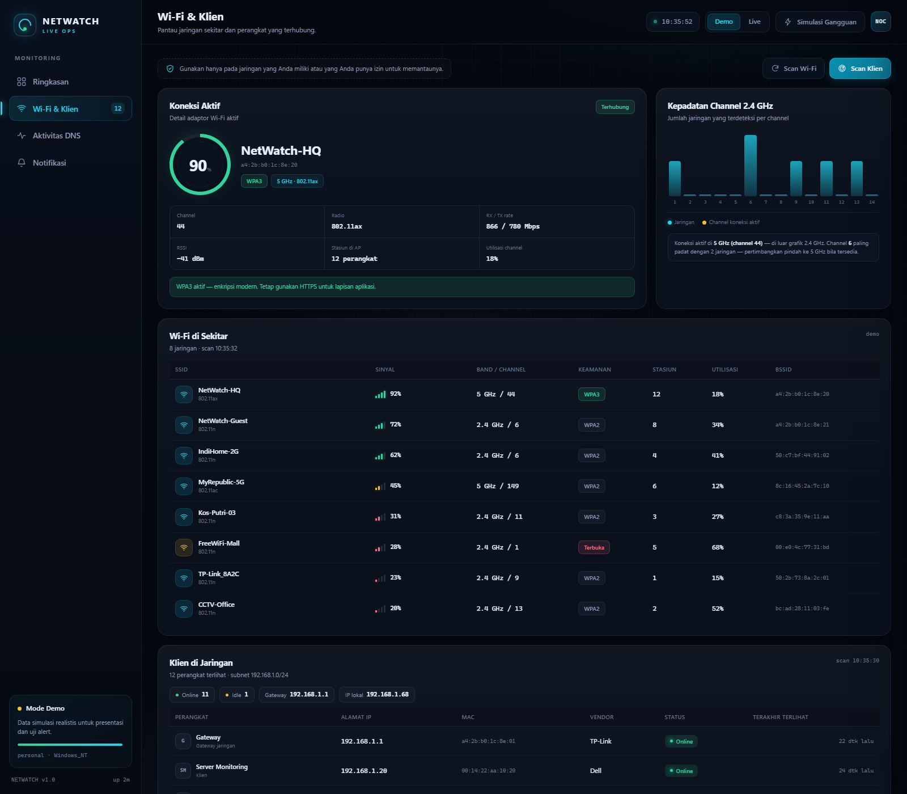
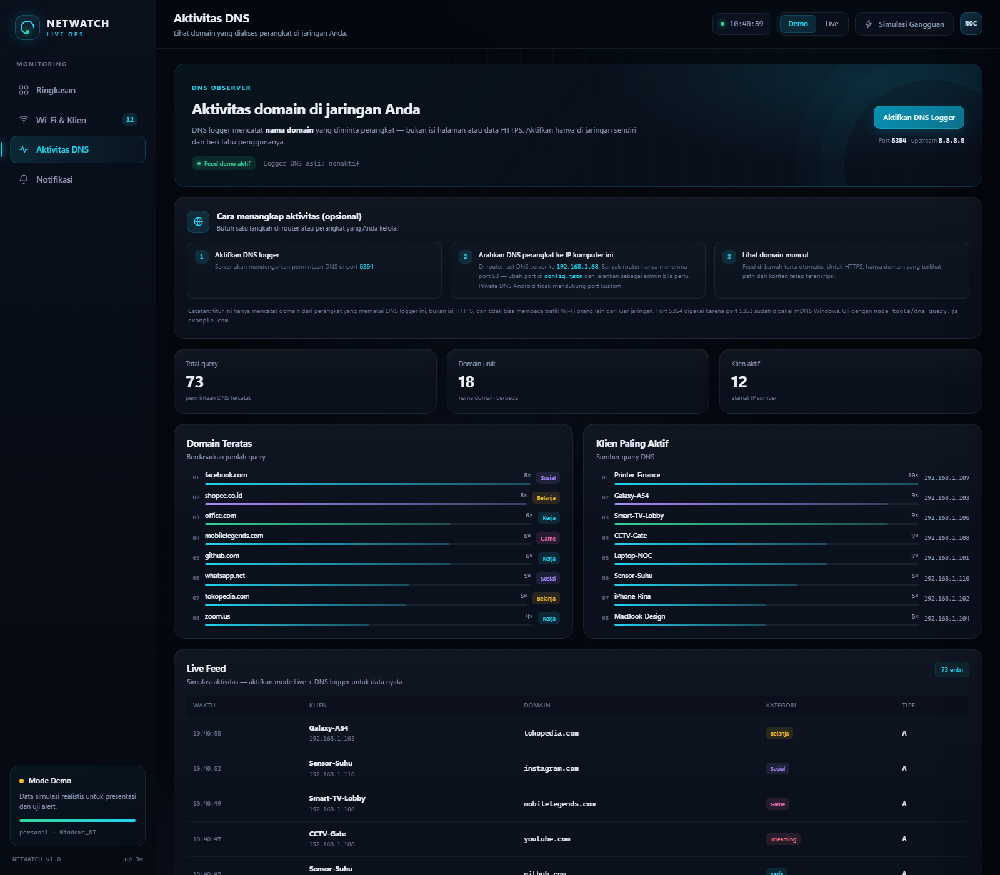
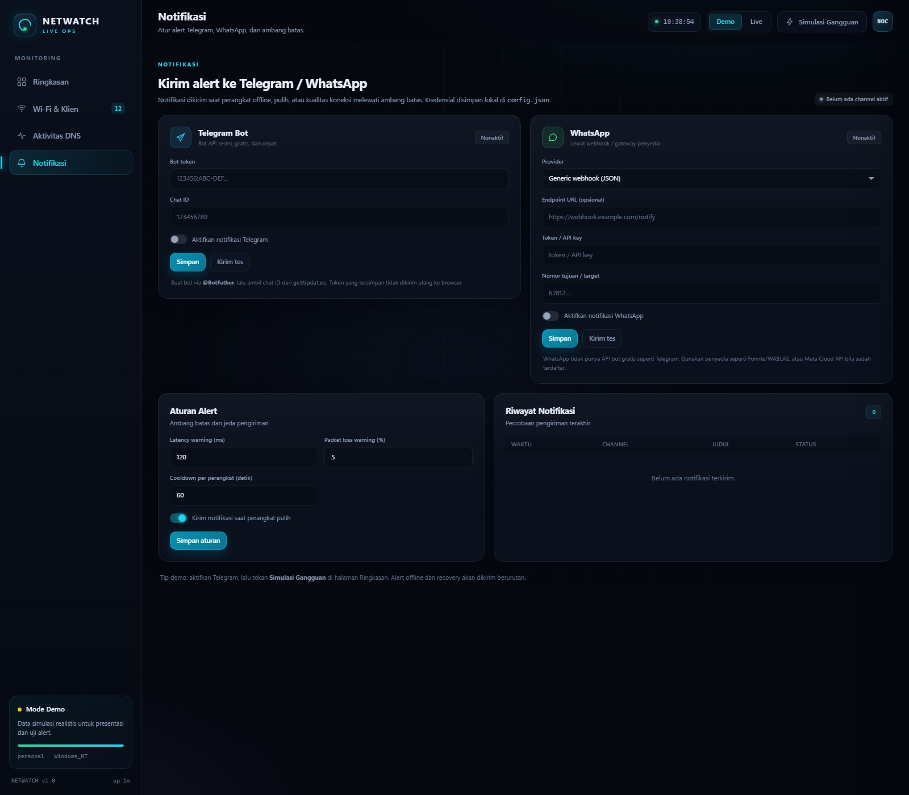

# NetWatch Live — Dashboard Monitoring Jaringan Real-Time

Dashboard NOC (Network Operations Center) berbasis web untuk memantau kesehatan jaringan secara langsung: status perangkat, throughput, latency, packet loss, Wi-Fi di sekitar, klien yang terhubung, aktivitas domain DNS, serta alert ke Telegram dan WhatsApp.

**Demo online (mode demo):** https://netwatch-live-psi.vercel.app

Aplikasi ini **tanpa dependensi npm** — cukup Node.js 18+ dan browser modern. Semua grafik digambar dengan canvas buatan sendiri, sehingga tetap ringan dan bisa dipakai offline.

```
┌──────────────────────────────────────────────────────────────┐
│  NETWATCH LIVE                          Mode Demo / Live     │
│  ┌─────────┐ ┌─────────┐ ┌─────────┐ ┌─────────┐             │
│  │ Online  │ │Throughput│ │ Latency │ │ Wi-Fi   │             │
│  └─────────┘ └─────────┘ └─────────┘ └─────────┘             │
│  Grafik throughput · latency per perangkat · event terbaru    │
│  Tabel perangkat · Wi-Fi sekitar · klien · aktivitas DNS      │
└──────────────────────────────────────────────────────────────┘
```

## Fitur

- **Status perangkat real-time** — online/offline/warning, latency, packet loss, availability, dan riwayat 60 sampel terakhir.
- **Grafik throughput** — unduh/unggah dari counter NIC (mode live) atau simulasi realistis (mode demo).
- **Grafik latency per perangkat** — termasuk sparkline di tabel dan drawer detail perangkat.
- **Wi-Fi sekitar** — SSID, BSSID, sinyal, channel, band, keamanan, dan jumlah station (mode live memakai `netsh wlan`).
- **Klien terhubung** — daftar perangkat di LAN dari tabel ARP, dengan nama, IP, MAC, dan vendor.
- **Aktivitas DNS** — domain yang di-query, kategori, klien sumber, top domain, dan live feed.
- **Alert Telegram & WhatsApp** — notifikasi saat perangkat down, latency tinggi, atau loss melewati ambang; plus notifikasi pemulihan.
- **Simulasi gangguan** — tombol satu klik di mode demo untuk memperagakan alert dan banner offline.
- **SSE (Server-Sent Events)** — UI diperbarui otomatis tanpa polling berat.
- **Mode demo & live** — demo langsung jalan tanpa konfigurasi; live memakai data nyata dari komputer ini.

## Tampilan

| Ringkasan | Wi-Fi & Klien |
|---|---|
|  |  |

| Aktivitas DNS | Notifikasi |
|---|---|
|  |  |

## Kebutuhan

| Kebutuhan | Keterangan |
|---|---|
| Node.js | 18 atau lebih baru (disarankan 20+) |
| OS | Windows 10/11 untuk fitur live (`ping`, `netsh wlan`, `netstat`, `arp`) |
| Browser | Chrome, Edge, Firefox, atau Safari modern |
| Hak akses | Tidak perlu admin untuk port 8787 dan DNS logger 5354 |

Mode demo berjalan di Windows, Linux, dan macOS. Fitur live yang memakai perintah Windows hanya aktif di Windows.

## Menjalankan

### Cara cepat (Windows)

1. Pastikan Node.js sudah terpasang: `node -v`.
2. Klik dua kali **`start.bat`**.
3. Browser terbuka otomatis di `http://127.0.0.1:8787`.

### Cara manual

```bat
cd netwatch-live
npm start
```

Atau:

```bat
node server.js
```

Server membuka browser secara otomatis. Untuk menjalankan tanpa membuka browser (misalnya di server):

```bat
node server.js --no-open
```

## Akses publik + monitoring live (Cloudflare Tunnel)

Vercel tidak bisa menjalankan monitoring live (serverless, tanpa ICMP/`netsh`/ARP/UDP). Supaya fitur live tetap bekerja **dan** bisa dibuka dari mana saja, jalankan server di komputer Anda lalu publikasikan lewat Cloudflare Tunnel.

### 1. Siapkan kredensial

Buat file `live-auth.cmd` di folder proyek (sudah masuk `.gitignore`, jadi tidak ikut ter-commit):

```bat
set NETWATCH_USER=netwatch
set NETWATCH_PASS=gantiDenganPasswordAnda
```

### 2. Jalankan

Klik dua kali **`start-live.bat`**. Skrip ini:

1. Menjalankan `server.js` dalam mode live.
2. Mengunduh `cloudflared` otomatis bila belum ada.
3. Membuat tunnel publik dan menampilkan alamat `https://xxxxx.trycloudflare.com`.

Salin alamat tersebut, lalu buka di browser. Login memakai username/password dari `live-auth.cmd`.

### 3. Link sekali klik (opsional)

Supaya tidak perlu mengetik password (nyaman di HP), buka:

```
https://xxxxx.trycloudflare.com/?k=<token>
```

Token = 32 karakter pertama SHA-256 dari `user:password`. Contoh membuatnya di PowerShell:

```powershell
$h = [BitConverter]::ToString(
  [Security.Cryptography.SHA256]::Create().ComputeHash(
    [Text.Encoding]::UTF8.GetBytes("netwatch:gantiDenganPasswordAnda")
  )
).Replace("-","").ToLower()
$h.Substring(0,32)
```

Setelah link dibuka, server menyimpan sesi di cookie `HttpOnly` dan mengalihkan ke URL bersih, jadi token tidak tertinggal di address bar.

### Catatan penting

- Alamat `trycloudflare.com` **berubah setiap kali** tunnel dijalankan ulang.
- Komputer harus menyala dan `start-live.bat` harus tetap berjalan.
- Jangan bagikan link/token ke publik. Siapa pun yang punya link bisa melihat dashboard.
- Untuk alamat tetap, gunakan **named tunnel** dengan domain sendiri (butuh akun Cloudflare).

## Wi-Fi di sekitar perangkat teman (multi-lokasi)

Browser **tidak bisa** memindai daftar Wi-Fi di sekitar pengunjung — tidak ada API-nya, dan ini batasan keamanan browser. Karena itu NetWatch memakai **agent** yang dijalankan di perangkat teman.

| Perangkat | Agent | Kebutuhan |
|---|---|---|
| Windows | `agent/agent.bat` | Tidak perlu install apa pun (memakai PowerShell bawaan) |
| Android | `agent/termux.sh` | Termux + Termux:API dari F-Droid, izin lokasi, GPS menyala |
| Linux | `agent/agent.sh` | `nmcli` (NetworkManager) |
| macOS | `agent/agent.sh` | `airport` (bisa tidak tersedia di Sonoma ke atas) |

Langkah singkat:

1. Ambil **kunci agent** dari `config.json` → `agent.key` (atau env `NETWATCH_AGENT_KEY`).
2. Kirim folder `agent/`, alamat tunnel, dan kunci agent ke teman Anda.
3. Teman menjalankan agent dan mengisi nama lokasi (contoh `Laptop Budi`).
4. Buka dashboard → **Wi-Fi & Klien** → pilih lokasi di dropdown **Lokasi dipantau**.

Panduan lengkap: [`agent/README.md`](agent/README.md)

Endpoint yang dipakai agent: `POST /api/agent/ingest` dengan header `x-agent-key`. Kunci ini hanya bisa mengirim data — tidak bisa membuka dashboard.

## Deploy ke Vercel (demo showcase)

Repo ini sudah dilengkapi adapter serverless di `api/index.js` dan `vercel.json`, sehingga bisa di-deploy ke Vercel untuk **demo publik**.

1. Buka [vercel.com/new](https://vercel.com/new).
2. Import repo GitHub `netwatch-live`.
3. Framework preset: **Other**.
4. Build command: kosongkan.
5. Output directory: `public` (sudah diatur `vercel.json`).
6. Klik **Deploy**.

Atau lewat CLI:

```bat
npx vercel --prod
```

**Penting — batasan Vercel:**

| Fitur | Di Vercel |
|---|---|
| Mode demo + simulasi gangguan | ✅ Jalan |
| Polling data demo | ✅ Jalan (SSE otomatis fallback ke polling) |
| Monitoring live (ping/netsh/ARP) | ❌ Tidak bisa (Linux serverless, tanpa ICMP) |
| DNS logger UDP | ❌ Tidak bisa |
| Simpan konfigurasi/token | ❌ Read-only |
| Alert Telegram/WhatsApp | ❌ Tidak dikirim dari demo Vercel |

Untuk monitoring **live** dan alert sungguhan, jalankan `server.js` di VPS, Render, Railway, Fly.io, atau komputer sendiri. Vercel hanya untuk memamerkan tampilan dashboard.

## Mode Demo vs Live

| | Demo | Live |
|---|---|---|
| Data perangkat | 12 perangkat simulasi | Target di `liveDevices` |
| Throughput | Simulasi realistis | Counter NIC via `netstat -e` |
| Latency/loss | Model simulasi | `ping` ICMP |
| Wi-Fi | SSID simulasi | `netsh wlan show networks` / `show interfaces` |
| Klien | Klien simulasi | Tabel ARP + ping sweep |
| DNS | Feed demo | DNS logger UDP nyata (opsional) |
| Alert | Bisa diuji dengan tombol simulasi | Berdasarkan ambang nyata |

Klik **Demo** atau **Live** di sidebar untuk berpindah mode. Pilihan terakhir disimpan ke `config.json`.

### Cara kerja mode live

1. **Gateway** — dideteksi otomatis dari `ipconfig` (default route), lalu di-ping.
2. **Target internet** — default `1.1.1.1` dan `8.8.8.8`; bisa diubah di `config.json`.
3. **Throughput** — total byte masuk/keluar dari `netstat -e`, dihitung sebagai selisih per interval.
4. **Wi-Fi** — SSID aktif, BSSID, sinyal, channel, dan station count dari `netsh wlan`.
5. **Klien** — entri ARP (`arp -a`) yang masih aktif, dilengkapi vendor MAC dari prefix OUI.
6. **Alert** — dikirim saat status berubah menjadi down, latency > `latencyMs`, atau loss > `lossPct`, dengan jeda `cooldownSec`.

> Catatan: ICMP/ping bisa diblokir oleh firewall atau jaringan tamu. Jika target selalu down padahal internet normal, coba target lain atau gunakan mode demo.

## Alert Telegram

1. Buka Telegram, cari **@BotFather**, lalu `/newbot`.
2. Ikuti instruksi; simpan **bot token** (format `123456:ABC...`).
3. Kirim pesan apa saja ke bot Anda.
4. Buka `https://api.telegram.org/bot<TOKEN>/getUpdates`, cari `"chat":{"id":...}`. Itu **chat ID** Anda.
5. Di dashboard, buka **Notifikasi**, isi token dan chat ID, aktifkan Telegram, lalu klik **Tes Telegram**.
6. Atur ambang latency, loss, dan cooldown di kartu **Aturan Alert**.

Bot akan mengirim pesan saat:
- perangkat down / pulih,
- latency melewati ambang,
- packet loss melewati ambang.

## Alert WhatsApp

WhatsApp tidak punya API bot gratis seperti Telegram. Dashboard menyediakan empat adapter:

| Provider | Field yang diisi | Catatan |
|---|---|---|
| **Generic webhook** | URL, token (opsional), target | Mengirim JSON `{ "target": "...", "message": "..." }` ke URL Anda. Cocok untuk n8n, Make, atau gateway sendiri. |
| **Fonnte** | Token, target | `https://api.fonnte.com/send`, body `target` + `message`. |
| **WABLAS** | Token, target | Default `https://pati.wablas.com/api/send-message`, body `phone` + `message`. |
| **Meta Cloud API** | Token, phoneNumberId, target | Graph API v20.0. Pesan teks bisnis ke pengguna di luar jendela 24 jam biasanya memerlukan template yang disetujui Meta. |

Isi di halaman **Notifikasi**, aktifkan WhatsApp, lalu **Tes WhatsApp**. Token disimpan di `config.json` dan tidak ditampilkan kembali di UI.

## DNS Logger (opsional)

DNS logger mendengarkan query DNS UDP dan meneruskannya ke upstream, sambil mencatat **nama domain** — bukan isi halaman atau trafik HTTPS.

### Mengaktifkan

1. Buka halaman **Aktivitas DNS**.
2. Klik **Aktifkan DNS logger**.
3. Server mendengarkan di **UDP 5354** dan meneruskan ke **8.8.8.8** (bisa diubah di `config.json`).
4. Uji dari terminal:

```bat
node tools/dns-query.js example.com
```

Jika berhasil, akan muncul balasan seperti:

```
Balasan dari 127.0.0.1:5354 — 60 byte, rcode=0, jawaban=2
```

dan domain `example.com` muncul di live feed.

### Agar perangkat lain memakai logger ini

Arahkan DNS perangkat (atau DHCP router) ke **IP LAN komputer ini**, port **5354** jika didukung. Sayangnya banyak perangkat hanya mendukung DNS port 53. Untuk itu:

- Ubah `dns.port` menjadi `53` di `config.json` (di Windows, port <1024 tidak selalu butuh admin, tetapi bisa bentrok dengan aplikasi lain).
- Pastikan Windows Firewall mengizinkan UDP 53/5354 untuk jaringan privat.
- Jangan arahkan seluruh jaringan ke logger ini tanpa izin pemilik jaringan.

### Batasan penting

- Hanya mencatat perangkat yang **memakai DNS logger ini**. Perangkat yang memakai DoH/DoT (Chrome, Firefox, aplikasi tertentu) tidak akan terlihat.
- Tidak bisa membaca isi HTTPS, password, atau chat.
- Tidak bisa memantau Wi-Fi orang lain dari luar jaringan. Tanpa akses ke router/DNS mereka, data tidak akan muncul.
- Data disimpan di memori (maksimal 300 entri) dan hilang saat server berhenti.

## Konfigurasi (`config.json`)

```jsonc
{
  "port": 8787,              // port dashboard
  "host": "127.0.0.1",       // 0.0.0.0 untuk akses dari perangkat lain
  "demoMode": true,          // true = demo, false = live
  "tickMs": 2000,            // interval simulasi (ms)
  "liveTickMs": 3000,        // interval ping live (ms)
  "telegram": {
    "enabled": false,
    "botToken": "",
    "chatId": ""
  },
  "whatsapp": {
    "enabled": false,
    "provider": "generic",   // generic | fonnte | wablas | meta
    "url": "",
    "token": "",
    "target": "",
    "phoneNumberId": ""
  },
  "thresholds": {
    "latencyMs": 120,
    "lossPct": 5,
    "cooldownSec": 60,
    "notifyRecovery": true
  },
  "liveDevices": [
    { "id": "gateway", "name": "Gateway Lokal", "host": "auto", "type": "router", "location": "Jaringan lokal" },
    { "id": "cloudflare", "name": "Cloudflare DNS", "host": "1.1.1.1", "type": "cloud", "location": "Internet" },
    { "id": "google", "name": "Google DNS", "host": "8.8.8.8", "type": "cloud", "location": "Internet" }
  ],
  "dns": { "enabled": false, "port": 5354, "upstream": "8.8.8.8" },
  "wifi": { "scanIntervalMs": 20000, "clientRefreshMs": 30000 }
}
```

`host: "0.0.0.0"` membuat dashboard bisa diakses dari HP/LAN. Tanpa `NETWATCH_USER`/`NETWATCH_PASS`, **tidak ada autentikasi**, jadi hanya lakukan di jaringan tepercaya.

### Environment variable

| Variabel | Fungsi |
|---|---|
| `PORT` | Menimpa port dashboard |
| `HOST` | Menimpa host bind |
| `NETWATCH_CONFIG` | Path config alternatif |
| `NETWATCH_DEMO=1` / `0` | Paksa mode demo/live |
| `NETWATCH_USER` | Username Basic Auth (wajib bersama `NETWATCH_PASS`) |
| `NETWATCH_PASS` | Password Basic Auth |
| `NETWATCH_AGENT_KEY` | Kunci untuk agent multi-lokasi (menimpa `agent.key`) |

Jika `NETWATCH_USER` dan `NETWATCH_PASS` diisi, seluruh dashboard dan API dilindungi password. Login bisa lewat prompt browser (Basic Auth) atau link `?k=<token>` yang memasang cookie sesi.

Contoh:

```bat
set PORT=9000
set NETWATCH_DEMO=0
set NETWATCH_USER=netwatch
set NETWATCH_PASS=rahasia
node server.js
```

## API

| Method | Endpoint | Fungsi |
|---|---|---|
| GET | `/api/state` | Snapshot lengkap (KPI, perangkat, trafik, Wi-Fi, klien, DNS, alert) |
| GET | `/api/stream` | SSE stream snapshot real-time |
| GET | `/api/health` | Health check + uptime + jumlah klien SSE |
| POST | `/api/mode` | `{ "mode": "demo" \| "live" }` |
| POST | `/api/incident` | Simulasi gangguan (demo saja) |
| POST | `/api/scan/wifi` | Paksa scan Wi-Fi |
| POST | `/api/scan/clients` | Paksa scan klien LAN |
| POST | `/api/dns` | `{ "enabled": true \| false }` |
| POST | `/api/notify/test` | `{ "channel": "telegram" \| "whatsapp" }` |
| POST | `/api/config` | Simpan konfigurasi Telegram/WhatsApp/ambang |

Contoh:

```bat
curl -X POST http://127.0.0.1:8787/api/incident
curl -X POST http://127.0.0.1:8787/api/mode -H "Content-Type: application/json" -d "{\"mode\":\"live\"}"
```

## Struktur Proyek

```
netwatch-live/
├─ server.js              HTTP server, routing, SSE, config
├─ api/index.js           adapter Vercel (demo serverless)
├─ vercel.json            konfigurasi deploy Vercel
├─ config.json            konfigurasi runtime (tidak di-commit)
├─ start.bat              launcher Windows (lokal)
├─ start-live.bat         launcher live + Cloudflare Tunnel
├─ live-auth.cmd          username/password live (tidak di-commit)
├─ agent/
│  ├─ agent.bat           agent Windows (paling mudah)
│  ├─ agent.ps1           pemindai Wi-Fi Windows
│  ├─ agent.sh            agent Linux/macOS
│  ├─ termux.sh           agent Android (Termux)
│  └─ README.md           panduan agent
├─ tools/
│  └─ dns-query.js        klien uji DNS logger
├─ lib/
│  ├─ monitor.js          mesin monitoring, alert, snapshot
│  ├─ defaults.js         konfigurasi default
│  ├─ demo.js             simulasi perangkat/Wi-Fi/klien/DNS
│  ├─ network.js          ping, gateway, netstat, ARP, vendor MAC
│  ├─ wifi.js             parser netsh wlan, scan Wi-Fi & klien
│  ├─ dnslog.js           DNS proxy/logger UDP
│  ├─ notifier.js         Telegram & WhatsApp
│  └─ util.js             helper
└─ public/
   ├─ index.html          markup dashboard
   ├─ css/style.css       tema NOC gelap + responsif
   └─ js/
      ├─ app.js           state, render, form, navigasi
      └─ charts.js        grafik canvas
```

## Troubleshooting

**Port 8787 sudah dipakai**

```bat
netstat -ano | findstr :8787
taskkill /PID <PID> /F
```

Atau ubah `port` di `config.json`.

**Config tidak terbaca / JSON tidak valid**

Pastikan `config.json` disimpan sebagai UTF-8 tanpa BOM. Aplikasi sudah menstripping BOM, tetapi editor tertentu bisa menambahkan karakter aneh. Kembalikan ke default dengan menghapus file — server akan memakai default.

**DNS logger gagal bind (EADDRINUSE)**

Port 5353 biasanya dipakai mDNS Windows. Gunakan 5354 (default). Jika port 53 dipakai aplikasi lain (Docker, Pi-hole, ICS), pilih port lain.

**Wi-Fi tidak terdeteksi di mode live**

- Aktifkan **Location Services** di Windows (Settings → Privacy → Location).
- Pastikan adapter Wi-Fi aktif dan terhubung.
- Coba `netsh wlan show networks mode=bssid` di terminal.

**Ping selalu gagal**

Beberapa jaringan memblokir ICMP. Coba target lain, atau tetap pakai mode demo untuk presentasi.

**Browser tidak terbuka otomatis**

Buka manual `http://127.0.0.1:8787`, atau jalankan `node server.js` tanpa `--no-open`.

## Batasan & Etika

- Dashboard ini memantau **jaringan milik Anda sendiri** atau jaringan yang Anda punya izin untuk pantau.
- Tidak ada fitur untuk menembus Wi-Fi orang lain, membobol password, atau membaca trafik terenkripsi.
- Melihat daftar SSID di sekitar adalah hal yang wajar (seperti daftar Wi-Fi di HP), tetapi menyamar sebagai AP, menangkap handshake, atau mengintip trafik pengguna lain bisa melanggar hukum.
- DNS logger hanya mencatat domain dari klien yang memakai logger tersebut; bukan isi komunikasi.
- Dashboard belum memiliki autentikasi. Jangan expose ke internet publik tanpa reverse proxy + auth (misalnya Nginx + Basic Auth / Cloudflare Access).

## Roadmap

- [ ] SNMP v2c/v3 untuk switch/router (interface counters, CPU, uptime)
- [ ] Dukungan Prometheus exporter + Grafana
- [ ] Autentikasi dan multi-user
- [ ] Penyimpanan historis (SQLite/InfluxDB)
- [ ] Notifikasi Slack/Discord/email
- [ ] Agent ringan untuk remote site
- [ ] PWA + tampilan TV mode

## Lisensi

MIT — bebas dipakai dan dimodifikasi untuk kebutuhan belajar maupun operasional.
